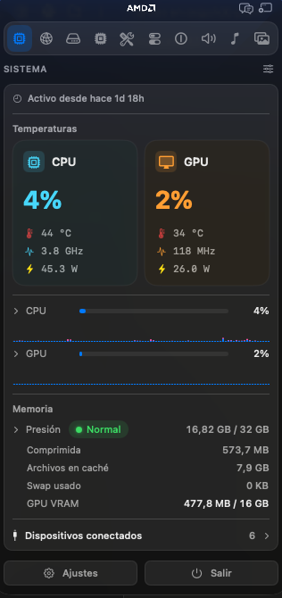
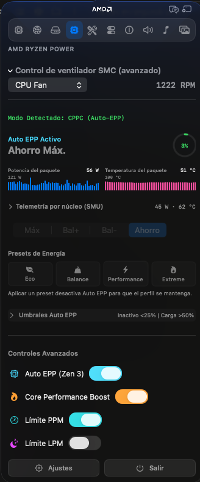
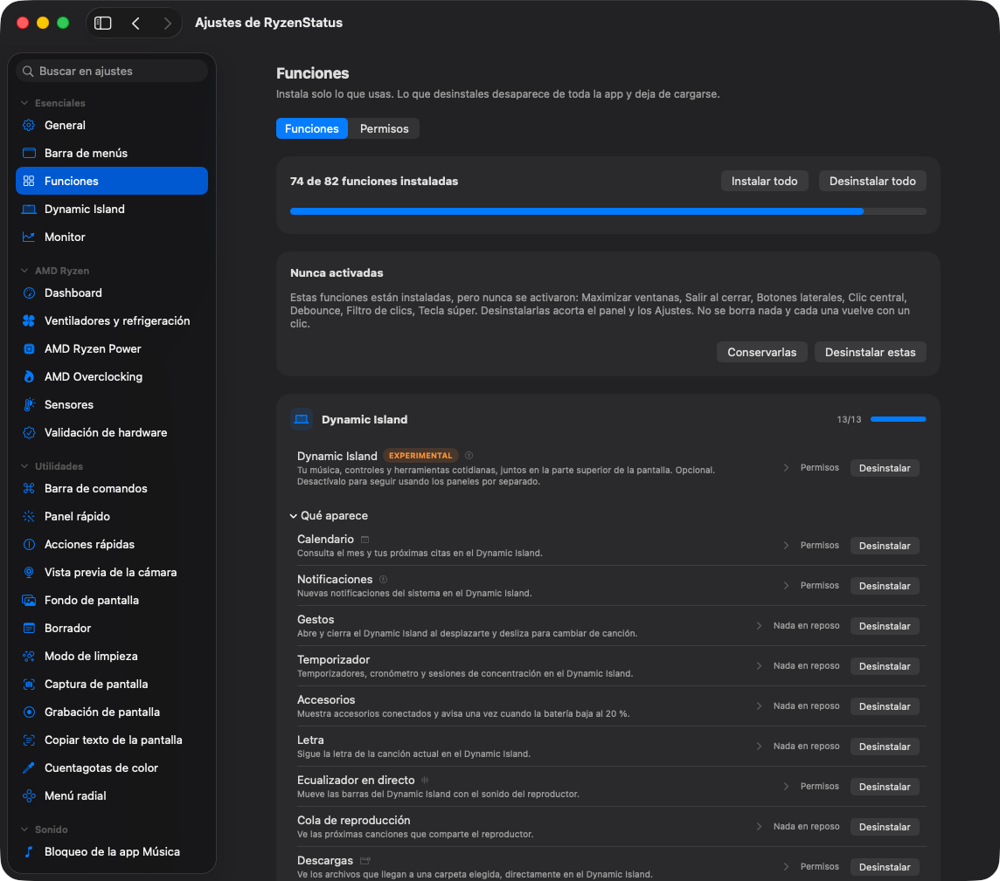
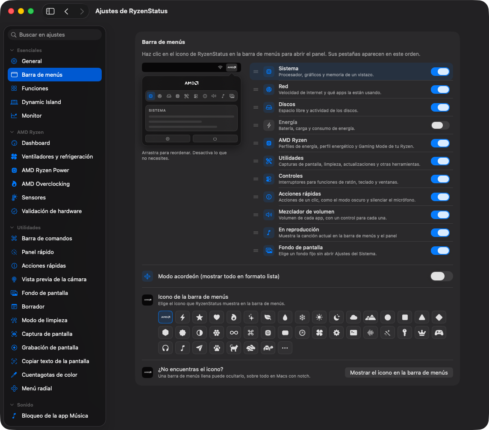
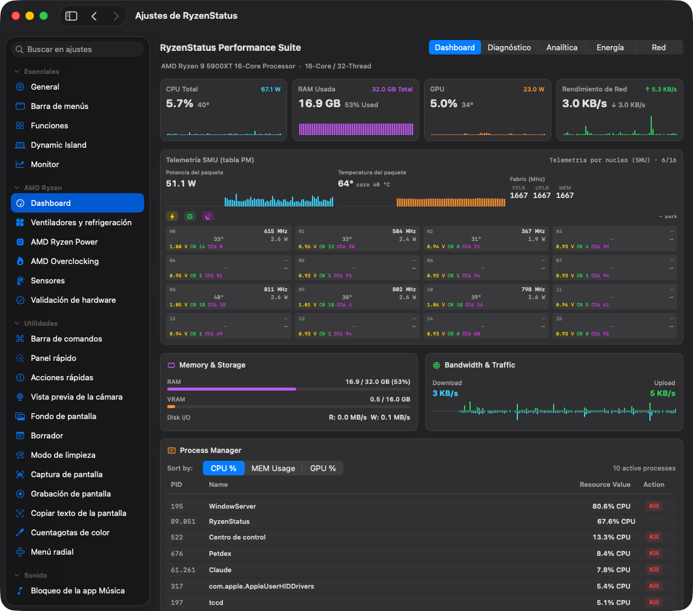
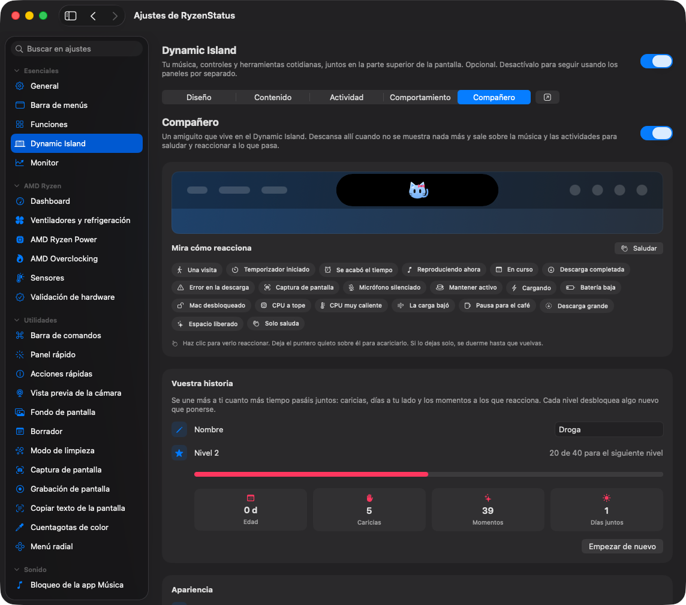
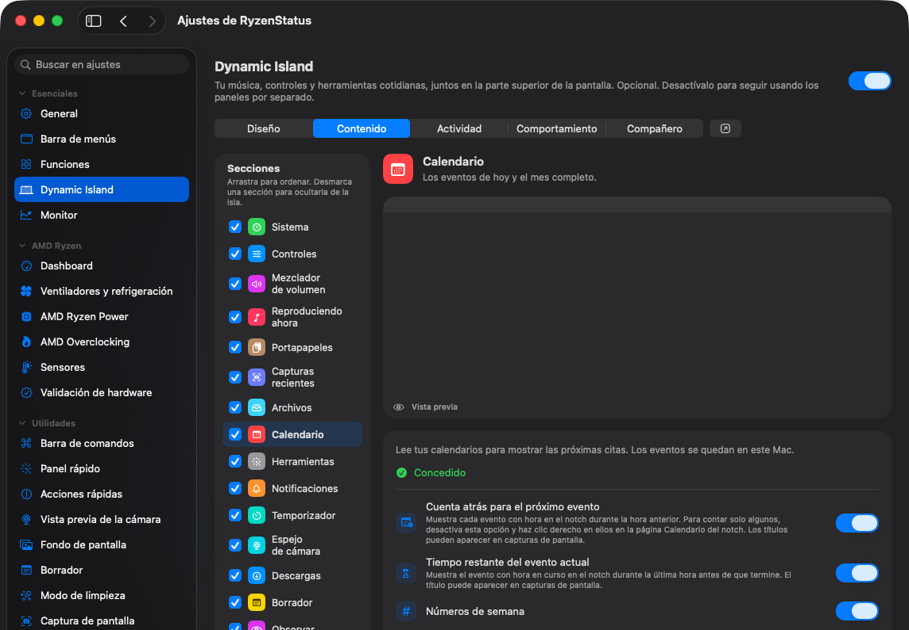

<p align="center">
  <picture>
    <source media="(prefers-color-scheme: dark)" srcset="docs/assets/readme/logo-dark.png">
    
  </picture>
</p>

<h1 align="center">RyzenStatus</h1>

<p align="center">
  One menu bar icon doing the job of a dozen paid Mac apps.<br>
  Free, open source, and everything runs on your Mac.
</p>

<p align="center">
  <a href="https://github.com/DrogaBox/ryzenstatus-utils">GitHub</a> ·
  <a href="#install">Install</a> ·
  <a href="#everything-it-does">Features</a> ·
  <a href="#private-by-default">Privacy</a> ·
  <a href="CHANGELOG.md">Changelog</a>
</p>

<p align="center">
  <a href="https://github.com/DrogaBox/ryzenstatus-utils/releases"></a>
  <a href="https://github.com/DrogaBox/ryzenstatus-utils/releases"></a>
  <a href="https://github.com/DrogaBox/ryzenstatus-utils/actions/workflows/ci.yml"></a>
  <!-- align advertised OS version with Package.swift/Info.plist minimum macOS 14.0 through macOS 26 Tahoe -->
  <a href="#what-you-need"></a>
  <a href="LICENSE"></a>
</p>

<p align="center">
  
  
</p>

Per app volume, a real system monitor with AMD Ryzen telemetry and fan curves, a Dynamic Island with a companion that follows your hardware, a Command Bar, a better app switcher, window snapping, Dock previews, clipboard history, text snippets, a file shelf, an uninstaller. The utilities Mac users usually buy one by one, together behind a single menu bar icon, with no account, no telemetry and no subscription.

## Install only what you use

Nobody needs all of it, and RyzenStatus is built around that. The Features page installs and uninstalls whole features: what you uninstall disappears from the entire app and stops loading, so it spends no CPU, memory or energy. Nothing is deleted, and installing again brings your old settings back. Features you installed but never switched on are offered for removal in one batch, with Undo.

Three one click bundles, Essentials, Windows, and Battery and quiet, shape the whole app in one move, and onboarding ends by asking which one you want. Every feature also wears an honest energy badge saying what it keeps alive while on.

<p align="center">
  
</p>

The rest bends the same way: Settings is grouped by tool and searchable down to the exact setting, the menu bar panel has an editor with a live miniature to reorder and hide its sections, settings export to a file and import on a new Mac, and the whole app speaks fifteen languages: English (US), Português (Brasil), Español, Deutsch, Français, Italiano, 日本語, 한국어, Русский, Türkçe, Slovenčina, Українська, 简体中文, 繁體中文 (香港), and 繁體中文 (台灣).

<p align="center">
  
</p>

## Everything it does

### Know what your Mac is doing

- **Menu bar monitor.** Keep the readings you care about in the bar itself: values, usage bars or history graphs drawn as one-point columns with the newest sample on the right. Network and disk put upload or writes above and download or reads below.
- **Graph themes.** Follow the system accent or pick one of ten palettes, soft variants or monochrome, separately for light and dark menu bars. The same columns are used in the panel, the metric details, the dashboards and the Dynamic Island.
- **Your own menu bar icon.** Pick any system symbol to stand in for the RyzenStatus mark, from a gallery or by name.
- **System monitor.** CPU (user and system time, average clock), GPU, memory pressure and app memory, temperatures, disk and power, with history graphs, metric detail pages, iStats widgets and a btop-style dashboard.
- **Network.** Live rates in MB/s or Mbps, session totals, the per app list, each interface's local IP address and a built in speed test.
- **Alerts.** Optional notifications for sustained CPU load, CPU and GPU temperature, GPU power, memory pressure, low disk space and low battery, in your temperature unit.

### AMD Processors & Power Management

All AMD pages live together in their own **AMD Ryzen** section of Settings: dashboard, fans, power, overclocking, sensors and hardware validation.

- **AMD Telemetry:** Real-time monitoring of AMD CPU package/core temperatures, power draw against the PPT limit, and frequencies per core.
- **Kernel-Native Dynamic Fan Curves:** Hardware fan control evaluated directly inside `AMDRyzenCPUPowerManagement.kext` at a 500 ms cadence with 256-point LUT interpolation, exponential moving average smoothing ($\alpha = 0.2$), hardware hysteresis, ramp rate limiting, and an emergency thermal guard ($\ge 85$ °C $\to$ PWM $\ge 200$), eliminating userspace polling overhead. Curves are put back at launch and after the kext reconnects, and the fan safety checks keep running with Settings closed.
- **GPU Temperature Bridge:** Native discrete GPU temperature forwarding (selector 103) allowing fan curves driven directly by GPU thermal loads.
- **Interactive Staged Curve Editor:** Curve editor featuring 256-point visual preview, live sensor tracking markers, 4-curve slot management, 1% minimum duty cycle floor, and explicit Apply / Revert actions to prevent unintended fan spin-ups while editing.
- **SuperIO Hardware Read-Back:** Accurate fan speed (RPM) and duty cycle (PWM %) derived directly from physical SuperIO chips (Nuvoton NCT668X / NCT67XX, ITE IT86XXE).
- **Power presets per CPU:** Eco, Balance, Performance and Extreme carry the PPT/TDC/EDC and Tctl limits ZenTune publishes for your CPU's class (desktop X3D, E, X 9-series, X, standard; desktop and mobile APUs), together with deep idle, boost and EPP. Each card shows the values that apply on your CPU.
- **Auto EPP:** Moves the CPU between the Eco, Balance and Performance presets by your idle and load thresholds, stepping up at once and down slowly. An optional adaptive power limit trims PPT 5 W at a time above a target temperature and climbs back when the CPU cools.
- **Custom profiles:** Your own combinations of every lever, exported to a JSON file, imported back, or imported from a ZenTune backup.
- **Deep idle (CC6):** Idle cores sleep in CC6 instead of only halting, switched on and off live from settings, no restart.
- **EPP through MSRs or ACPI:** Energy Performance Preference reaches CPUs with the CPPC MSRs directly and, on CPUs that publish CPPC only through ACPI (`_CPC` and PCC shared memory, such as Ryzen 5000 desktop parts), through PCC. Hardware Validation shows which path your CPU uses and what the driver found.
- **SMU controls for every family:** PPT/TDC/EDC (or STAPM/fast/slow on APUs), cHTC, PBO scalar, OC mode with frequency and voltage, Curve Optimizer and a boost ceiling go through the command set of your CPU's family (Zen and Zen+, Zen 2, Zen 3, AM5, and the Raven Ridge, Renoir/Cezanne and Rembrandt/Phoenix APUs). A control your CPU does not accept says so instead of sending a command meant for another chip.
- **Gaming Mode:** A one-click toggle to apply the Extreme power preset and prevent display sleep during intense workloads.

<p align="center">
  
</p>

### Dynamic Island and companion

- **Dynamic Island.** An optional island at the top of the screen that brings music, controls and everyday tools together: Now Playing with lyrics, queue and a live equalizer, timers, downloads, notifications, upcoming calendar events, gestures, accessory and input source notices, and live CPU, GPU and memory cards. Off by default.
- **No notch needed.** On displays without a notch, compact activities and the resting companion stay in the menu bar and expanded panels open below it. The middle of the capsule can show the song, a live metric or the time.
- **Watch any window.** Turn any part of any window into a live activity, with an alert when it changes, finishes or shows what you are waiting for.
- **A companion that grows.** Give it a name and watch it reach ten levels with pats and time together, unlocking accessories (glasses, scarf, headphones, a crown and more), with seasonal costumes and its own greetings. It follows your AMD hardware: the fan companion spins at your CPU fan's real speed and the chip glows with package power.
- **AI agents, opt in.** Tokens, plan limits and work in progress for Claude Code, Codex, OpenCode and GitHub Copilot, read from their local history files. Off by default.

<p align="center">
  
  
</p>

### Sound, Media & Now Playing

- **Volume mixer.** Slide any single app up or down while the rest of the Mac stays put, and push a quiet one past 100 percent when a video is just too low. No audio driver, no setup.
- **Per app output.** Send your music to the speakers and a call to your headset at the same time.
- **Output switcher and audio priority.** Cycle between chosen outputs with one shortcut, rank your devices so the best one connected is used automatically, and drop the volume when headphones disconnect.
- **Microphone tools.** Pin your favorite input so the Mac stops guessing, and mute the mic everywhere with a click or shortcut.
- **Music app blocker.** Stops the Music app from bursting in when a media key or headphones launch it, opens the player you prefer instead, and can start playback in it.
- **Now Playing floating player.** A detachable floating desktop widget with compact Mini Card and regular view modes, right-click quick resize, pin-on-top, and adaptive background theming (6 palette styles) extracted live from album artwork.
- **Live animated artwork.** Streams Apple Music motion album covers in real time with seamless crossfades between video and static cover art.
- **Synced lyrics & song credits.** Synchronized LRC line-by-line scrolling lyrics, plain lyrics view, detailed track credits (composer, release year, genre, bitrate), and manual provider search.
- **Universal transport controls.** Play/Pause, Next/Previous, Shuffle, Repeat, a seekable progress bar, and configurable global media hotkeys with smart single dispatch for Apple Music, Spotify, and browser media sessions.
- **Now Playing menu bar item.** Track title, artist and a compact progress bar right in the menu bar, with configurable display modes.

### Windows and the Dock

- **App switcher.** A richer take on pressing ⌘Tab, with live window thumbnails, minimized windows included, and more than one window per app.
- **Window layout.** Snap the active window to halves, thirds, sixths, corners, center or another display, each with its own optional shortcut. On a trackpad or mouse, hold chosen modifiers and drag anywhere to move a window, then add Shift to resize it.
- **Dock Preview.** Hover a Dock icon to peek at that app's windows and jump straight into the right one.
- **Dock clicks.** Click the Dock icon of the active app to minimize its windows, or cycle through them one by one.
- **Maximize windows.** The green button fills the screen without creating another Space, and puts the window back on the next click.
- **Quit on close.** Apps you choose quit when their last window closes.
- **Quit & close protection.** Guard ⌘Q and ⌘W behind a second press or a hold, per app or everywhere.
- **Spaces order.** Keep your Spaces in a fixed order, so macOS stops rearranging them by recent use.

### Keyboard and mouse

- **Command Bar.** One field that finds and runs everything the app does, from a global shortcut.
- **Text snippets.** Type a short trigger anywhere and it becomes your text, with date, time and clipboard variables, a snippet library and multi-line snippets pasted in one go.
- **Super Key.** Turn Caps Lock into an extra modifier, with a safety helper that hands the key back if the app is killed.
- **Mouse extras.** Smooth scrolling, independent scroll direction, Back and Forward side buttons, three finger middle click, focus follows mouse, acceleration off, linear and horizontal scrolling, and a click debounce for worn mice.
- **Key debounce.** Filters the double letters a worn keyboard invents.

### Clipboard, files and links

- **Clipboard history.** Local history of text, images and files with pinned favorites, search, skipped apps, in-sidebar editing, quick paste shortcuts and optional clearing after a delay, on sleep or on screen lock.
- **Paste as plain text.** One shortcut pastes without fonts, colors or links, and the original stays on the clipboard.
- **Shelf.** Park files, text and links near your cursor mid drag, then drop them where they belong later.
- **Finder cut and paste, and rename.** ⌘X and ⌘V move files the way you always expected them to, and a shortcut renames the selected file.
- **Clean URL.** Strips tracking parameters from copied links, with every rule listed and switchable by site, your own per-site parameters, and a note of what was removed.
- **Disk image installer.** Opening a downloaded `.dmg` offers to install the app inside and tidy the download away.

### Everyday tools

- **Quick panel and toggles.** ⌃⌘V opens a floating palette with your favorite tools, and one-click system actions sit in their own panel tab: dark mode, empty the Trash, eject every disk, hidden files, lock the screen and more.
- **Radial menu.** Hold a shortcut, or a spare mouse button, and a wheel of your favorite actions opens around the pointer.
- **Screen Recorder.** Record the screen, a window or an area with optional microphone audio, then trim, annotate and export in the built-in editor.
- **Screenshot & Annotation Suite.** Capture on a frozen picture, then annotate, crop, redact, style the background and pin captures. QR codes are detected and decoded.
- **Copy text from screen.** Select any area and its text is recognized offline via Apple's Vision framework, straight onto the clipboard.
- **Image converter.** Saved profiles, exact or proportional resizing, renaming with tokens, text or logo watermarks, and video compression and GIFs, all locally.
- **Scratchpad.** A floating pad for short-lived text with Markdown preview, find, text size and background opacity. It saves as you type.
- **Cleaner and uninstaller.** Sweep app leftovers, caches, logs and forgotten screenshots by hand or on a schedule, and remove apps with all their files, including Homebrew casks.
- **Homebrew and MacPorts.** Search, install, update and remove packages without opening a terminal, and find updates for the apps you have.
- **Kill Process and Port Manager.** Search running processes and end whole process trees, and see which apps listen on which network ports.
- **Camera preview, color picker, wallpaper gallery and Cleaning Mode**, which locks the keyboard and blacks out every display while you clean.

### Energy and display

- **Keep awake.** Keep the Mac up for a timer, until a chosen time, until you say stop, or automatically with an external display or power connection, with the remaining time beside the icon.
- **Displays.** Adjust brightness or turn individual displays on and off from the menu bar panel, with hardware control on external screens when available.
- **Bluetooth.** Turn Bluetooth off when the Mac sleeps and back on when it wakes. On a Hackintosh with a slow or missing Bluetooth controller, one switch stops the app's own Bluetooth queries.

## Install

Grab the disk image from the [releases page](https://github.com/DrogaBox/ryzenstatus-utils/releases) and drag RyzenStatus into Applications.

## Uninstall

To remove RyzenStatus completely, including its settings and permissions:

```sh
./Tools/uninstall.sh
```

## Private by default

RyzenStatus has no backend, no account, no analytics and no tracking. The network is touched only by things you can see: update checks, the speed test, Now Playing lyrics/animated artwork streams, Homebrew and MacPorts searches and installs you start, and feedback you choose to send through GitHub. The AI agents section and calendar events only read files and data already on your Mac. The full story is in the [privacy notes](docs/PRIVACY.md).

Permissions get the same treatment. Every one is optional, the app explains each in plain words, shows which features actually use it, and even tells you when a permission you granted is no longer needed by anything, with a shortcut to revoke it.


| Permission | Used by | Without it |
|---|---|---|
| Accessibility | Switcher, Dock features, window controls, mouse and keyboard features, snippets, cut and paste | Those features stay off |
| Screen Recording | Switcher and Dock Preview thumbnails, copy text from screen, screen recordings | Previews fall back or stay off |
| System Audio Recording | Per app volume and output routing | Apps stay on normal system audio |
| Microphone, optional | Screen recordings with microphone audio | Recordings are video only without voice |
| Camera, optional | Camera preview mirror | The preview window stays off |
| Notifications | Keep awake, battery, monitor and update alerts | The app stays silent |
| Calendars, optional | Upcoming events in the Dynamic Island | The island shows no events |
| Bluetooth, optional | Accessory notices in the Dynamic Island and Bluetooth sleep | Those features stay off |
| Full Disk Access, optional | Deeper cleaner and uninstaller scans | Only reachable places are scanned |
| Administrator, once, optional | Password free closed lid toggling | A password prompt per toggle |

The shelf and almost every quick toggle need no permission at all. Finder cut and paste, the uninstaller, emptying the Trash and the Homebrew terminal handoff ask macOS for Automation access the first time they talk to Finder or Terminal.

## What you need

- A Hackintosh with an **AMD Ryzen CPU** (Zen architecture or newer)
- **macOS 14 Sonoma through macOS 26 Tahoe** for `RyzenStatus.app` (`AMDRyzenCPUPowerManagement.kext` and `SMCAMDProcessor.kext` support macOS 13 Ventura through macOS 26 Tahoe)
- **Kernel Extensions (For AMD CPU telemetry & fan curves):** You must have `AMDRyzenCPUPowerManagement.kext` and `SMCAMDProcessor.kext` injected via OpenCore in your EFI folder. The source code for these is bundled in the `SMCAMDProcessor_Source` folder for reference.

### Kernel Extension Boot Arguments & Features

By default, any local process may read telemetry from the kext, while hardware **writes** (fan curves, EPP, P-States, SMU PBO/OC, and Curve Optimizer) require `root` privileges. You can configure the kext in your OpenCore `boot-args`:

- **`-amdcppcactive`**: Enables CPPC Active Mode at boot, allowing the OS to respect EPP (Energy Performance Preference) profiles like Power Save or Performance.
- **`amdcstate=1`**: Forbids deep idle (CC6). Since kext 3.40.0 deep idle is switched live from **Settings › AMD Ryzen Power › Advanced energy** and the app puts your choice back whenever the kext loads; the driver reads the firmware's C-state IO address (MSR `0xC0010073`) at start and never overwrites it. Without the argument, or with `amdcstate=0`, the switch is available.
- **`-amdnoidle`**: Leaves the idle loop to macOS (`hlt` only), for troubleshooting. Deep idle is then unavailable.
- **`-amdpnopchk`**: *(Optional — Security Trade-off)* Disables UserClient root privilege checks so RyzenStatus can control fans, EPP, P-States, and Curve Optimizer without running as `root`. **Warning:** when `-amdpnopchk` is set, *any* local process on the machine can issue privileged hardware writes through the UserClient; enable only on trusted single-user systems.
- **`-amdpdbg`**: Enables verbose debug logging (for troubleshooting panics or missing sensors).

#### Supported Sensors & Fan Control
The kext includes SuperIO support for reading and controlling fans on the following chip families:
- **Nuvoton (NCT668X / NCT67XX)**: NCT610XD, NCT6771F, NCT6776F, NCT6779D, NCT6791D, NCT6792D(A), NCT6793D, NCT6795D, NCT6796D(R), NCT6797D, NCT6798D, NCT6799D, NCT6701D, and NCT668X series.
- **ITE (IT86XXE)**: IT8688E, IT8686E, IT8665E, IT8689E.

This allows RyzenStatus to read fan speeds, hide/show headers, and apply dynamic custom fan curves directly from the macOS menu bar.

### Build it yourself

```sh
git clone https://github.com/DrogaBox/ryzenstatus-utils.git
cd ryzenstatus-utils
./build.sh            # compile, generate the icon, assemble the signed bundle
./build.sh --install  # the same, then install into Applications and launch
```

Xcode Command Line Tools are the only requirement. The [contributing guide](CONTRIBUTING.md) covers the layout and conventions. Official builds come only from the maintainer: the GPL covers the source, while the RyzenStatus name, icon and look are covered by [TRADEMARKS.md](TRADEMARKS.md), so forks need their own identity.

## When something misbehaves

The [troubleshooting guide](docs/TROUBLESHOOTING.md) walks through the common cases: the app blocked on first launch, a permission that will not stick, thumbnails showing as icons. To remove RyzenStatus completely, `./Tools/uninstall.sh` quits the app, drops the login item, resets its privacy grants and deletes every trace.

## Documentation

- [Privacy](docs/PRIVACY.md), what does and does not leave your Mac
- [Permissions](docs/PERMISSIONS.md), every macOS permission in plain words
- [Troubleshooting](docs/TROUBLESHOOTING.md), the common fixes
- [Contributing](CONTRIBUTING.md), build, layout and conventions
- [Support](SUPPORT.md), where to get help
- [Security](SECURITY.md), how to report a vulnerability

## Community

Bug reports, feature ideas and translations are all welcome, starting from the [contributing guide](CONTRIBUTING.md).

RyzenStatus is free and open source. If it earned its place in your menu bar, a star helps other people find it!

## License

[GPL 3.0 or later](LICENSE), copyright 2026 RyzenStatus. The license covers the source code; the RyzenStatus name, logo and look are covered separately in [TRADEMARKS.md](TRADEMARKS.md).

<p align="center">
  <sub>Made by DrogaBox</sub><br>
  <sub>RyzenStatus is a fork of <a href="https://github.com/vorssaint/vorssaint-utils">Vorssaint</a>, also released under the GPL 3.0 or later. Thanks to its authors for the foundation this app builds on.</sub>
</p>
